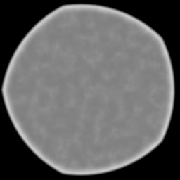

# <i class="fa-solid fa-circle"></i> Bokeh

OpenDefocus has a bokeh creation tool built in, on the Bokeh tab. This allows you to easily create realistic looking bokeh shapes.

---
## Filter type
The **Filter Type** parameter selects one of three shapes:

1. Simple
2. Disc
3. Blade

### Simple
The fast built-in filter. It is calculated on the fly, which costs a little less work. The other Bokeh parameters are ignored and greyed out.

### Disc
This shape does not have any edges and is perfectly circular.

### Blade
This shape allows you to set the number of corners with **Blades** (3 to 16 on the slider, default 5), and adjust its curvature with **Curvature** (default 0.5).

---
## Shape parameters
With Disc or Blade selected, these parameters shape the bokeh:

* **Radius**: the radius of the bokeh kernel.
* **Ring Color** and **Ring Size**: the brightness and width of the bokeh ring.
* **Inner Color**: the brightness of the bokeh interior.
* **Outer Blur** and **Inner Blur**: the softness of the outer and inner bokeh edges.
* **Angle**: the rotation of the bokeh shape.
* **Aspect Ratio**: the squeeze of the bokeh shape.
* **Noise Size**, **Noise Intensity**, **Noise Octaves** and **Noise Seed**: the noise applied to the bokeh shape.

Blades is only enabled for Blade.
