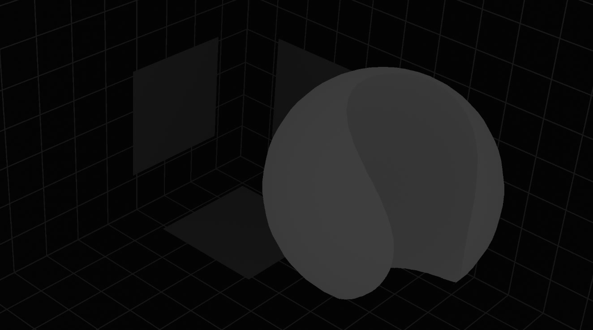
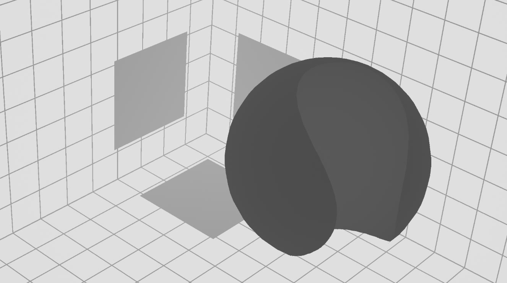

# <i class="fa-solid fa-subscript"></i> Depth math
The **Math** parameter (Defocus tab) is important when using depth based defocus, and should be the first thing to set up correctly.

It defines what kind of depth map is given to the Depth input. There are three options: Real, 1/Z and **Direct**, which bypasses the depth conversion.

---
## 1/Z
This is a depth map stored as the reciprocal of the distance (1/Z). The brighter the value, the closer it is to the camera. These values are always between 0 and 1. This is the default.

---

## Real
The value in a specific pixel is the distance in the scene's **World Unit** (set on the Camera tab). This is the most common depth map.

---

## Direct
With **Math** set to **Direct**, the Depth input is mapped directly to the size of the defocus in pixels. If you provide a value of 20 on a specific pixel, it will be defocussed by a size of 20.

It is also possible to define far and near field. Any negative value will be defined as in the far field, while any positive value will be defined as in the near field.

> [!IMPORTANT]
> While the direct map defines the size, it does not define the **Max Size**. Set your Max Size according to your expected or wished maximum value.
