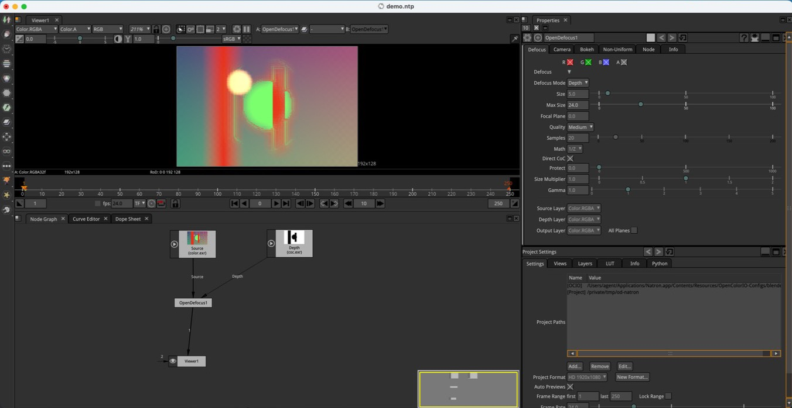
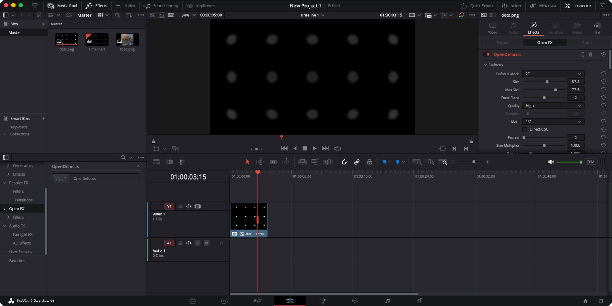

# <i class="fa-solid fa-plug"></i> Natron and DaVinci Resolve

OpenDefocus runs as an OpenFX plugin, so any host that loads OpenFX can use it. This page shows how to install it and use it in **Natron** and **DaVinci Resolve**.

| | <i class="fa-solid fa-circle-nodes"></i> Natron | <i class="fa-solid fa-film"></i> DaVinci Resolve |
| --- | --- | --- |
| Best for | Compositing with a separate **Depth** input | Grading and editing: the effect on a clip |
| Defocus modes | 2D and Depth | 2D (Depth needs a second input, see [below](#depth-in-resolve)) |
| Where it appears | Node menu, **OpenDefocus** | Effects, **Open FX > OpenDefocus** |
| Checked on | Natron 2.6 alpha, macOS arm64 | Resolve Free 21.1.1, macOS arm64 |

> [!NOTE]
> Only these combinations have been run. Linux, Windows, Resolve Studio and other versions should work, but are untested. Nuke Non-Commercial does not load OpenFX plugins.

---

## <i class="fa-solid fa-download"></i> Install

Install OpenDefocus from the [latest release](https://github.com/opendefocus/opendefocus/releases/latest), as described in [Installation](./installation.md), then **restart the host**. A host that is already running does not see a new plugin.

To install by hand, copy `OpenDefocus.ofx.bundle` into the OpenFX folder of your system:

| System | Folder |
| --- | --- |
| macOS | `/Library/OFX/Plugins` |
| Windows | `%CommonProgramFiles%\OFX\Plugins` |
| Linux | `/usr/OFX/Plugins` |

> [!IMPORTANT]
> The plugin renders on the GPU (through WGPU). The machine needs a GPU, or on Linux a software Vulkan driver such as Mesa lavapipe.

---

## <i class="fa-solid fa-circle-nodes"></i> Natron

OpenDefocus appears in the node menu under **OpenDefocus**. To try it without installing system-wide, start Natron with the folder that contains the bundle:

```sh
OFX_PLUGIN_PATH=/path/to/folder-with-bundle /path/to/Natron
```

### Depth defocus in four steps



1. Create the node and connect your image to **Source** (input 0).
2. Connect the depth map to **Depth** (input 1).
3. On the **Defocus** tab set **Defocus Mode** to **Depth**.
4. Set **Math** to what your depth map contains, and **Focal Plane** to the value that should stay sharp. See [Depth math](./detailed/depth_math.md) and [Focal plane](./detailed/focal_plane_setup.md).

The screenshot uses the bundled occlusion scene: a depth map with **Math** set to **Direct**, where each depth value is already a blur size in pixels.

From Python:

```python
node = app1.createNode("org.opendefocus.OpenDefocus")
node.connectInput(0, source)
node.connectInput(1, depth)
node.getParam("defocusMode").setValue(1)   # 1 = Depth
```

When you write the result, set the Write node to **32-bit float**. The default is half float.

---

## <i class="fa-solid fa-film"></i> DaVinci Resolve

After a restart, the effect is in the Effects library under **Open FX > OpenDefocus**. Drag it onto a clip on the Edit or Color page.



1. Drop **OpenDefocus** on the clip (or on a node).
2. Open the clip's **Inspector > Effects > Open FX** tab. The parameters are the same as everywhere else, in four groups: Defocus, Camera, Bokeh and Non-Uniform.
3. Set **Size** and **Max Size**. In the default **2D** mode the whole image is blurred by that size, and no depth map is needed.
4. Turn on Non-Uniform effects such as Catseye when you want a lens look. They centre on the middle of the frame.

> [!TIP]
> Resolve shows the generic effect icon for OpenDefocus. Resolve refuses the plugin's icon property, so the icon cannot be changed from the plugin.

### Depth in Resolve

On the Edit and Color pages an effect only gets the clip it sits on, so there is no place to connect a depth map. Use **2D** mode there.

Depth mode needs a second input. Whether and where Resolve offers one for OpenFX (for example in the Fusion page) has **not been tested** with OpenDefocus. If you try it, connect the depth map to the second input and follow the same four depth steps as in Natron.

---

## <i class="fa-solid fa-gauge-high"></i> Speed

Quality sets how exactly the blur is integrated:

| Quality | Use it for |
| --- | --- |
| **Fast** | Editing, scrubbing and playback. Quick preview-grade approximation. |
| **Accurate** (default) | Final renders. Exact integration, and the slowest. |

> [!WARNING]
> DaVinci Resolve renders Accurate noticeably slower than other hosts. Use **Fast** while you edit and switch to Accurate for the final render.

Large **Size** values and large frames cost more. If playback is heavy, drop to Fast while you work and switch to Accurate for the final render.

---

## <i class="fa-solid fa-triangle-exclamation"></i> Troubleshooting

- **The plugin does not show up.** Restart the host after copying the bundle, and check the folder in the table above.
- **"Rendering Failed" (Natron) or a black frame.** The reason is in the host's log. A common one is Depth mode with nothing connected to **Depth**: the log says "Depth clip is not connected".
- **Natron layers.** Only RGBA is processed. Layer selectors are ignored.
- **Camera input.** The optional Camera input only exists in hosts that provide the Nuke camera extension. In Natron and Resolve use the parameters on the **Camera** tab.
- **Big frames.** 4K frames can use around 2 GB of memory with Astigmatism on.
