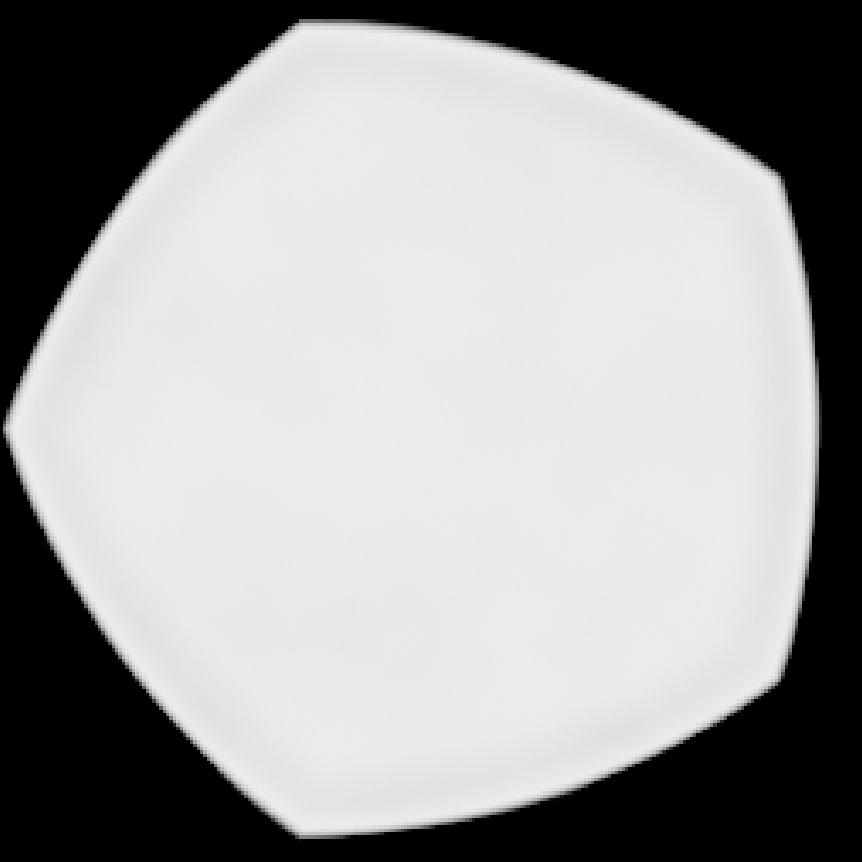
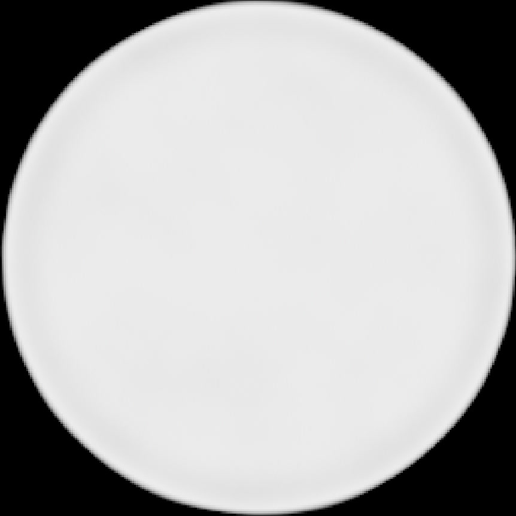

# <i class="fa-solid fa-circle"></i> Bokeh

## Bokeh tab
OpenDefocus includes an easy to use and extended bokeh tab. Allowing you to create any bokeh you'd like.

You can find the settings under the tab `Bokeh`.

---

### Filter type
The **Filter Type** parameter defines the shape creation. The plugin offers three choices:

* **Simple** (default): the fast built-in filter. It ignores the other Bokeh settings, which are greyed out.
* **Disc**: a round bokeh shape.
* **Blade**: a polygon shape similar to the `f`-stop blades.

---

#### Blade
When Blade is selected, the number of blades is set by the **Blades** parameter (3 to 16 on the slider, default 5). Blades is greyed out for Disc and Simple. The sharpness is defined by the **Curvature** parameter (default 0.5). Setting a value to 1 will make it entirely circular. Setting the value to 0 will make the corners sharp.

> Curvature comparison, curvature 0 and curvature 1

---

Under Disc and Blade, the other Bokeh parameters (Radius, Ring Color, Inner Color, Ring Size, Outer Blur, Inner Blur, Angle, Aspect Ratio and the Noise parameters) shape the result.
