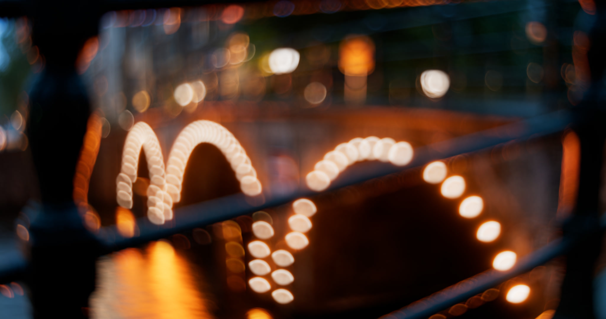

# <i class="fa-solid fa-shapes"></i> Non uniform

The Non-Uniform tab is responsible for any effects that are unique depending on their depth and position on screen. This can be a cutting, cropping, scaling, etc. effect.

This is where it gets really fun. There are now more effects than ever, including effects that were technically not possible at all before.

For a detailed technical explanations about these effects, like how they occur physically, I'd refer you to the [<i class="fa-solid fa-shapes"></i> Non uniform](../detailed/non_uniform/index.md) page.

Each effect has its own group with an **Enable** checkbox. Its other parameters are greyed out until the checkbox is on.

The **Inverse Foreground** parameter, at the top of the Non-Uniform tab, is on by default. See [Inverse non uniform in foreground](#inverse-non-uniform-in-foreground).

---

## Catseye
[<i class="fa-solid fa-cat"></i> Catseye](../detailed/non_uniform/catseye.md) is an effect that cuts the bokeh by itself depending on the position. It is not visible in the center, but most visible in the edges.

Its parameters are **Amount** (0 to 2, slider up to 1, default 0.5), **Gamma**, **Softness** and **Inverse**.

---

## Barndoors
[<i class="fa-solid fa-door-open"></i> Barndoors](../detailed/non_uniform/barndoors.md) is an effect that occurs when light is blocked by a barndoor/flare. This is attached to the lens itself.

With OpenDefocus all sides can be controlled uniquely: **Top**, **Bottom**, **Left** and **Right** each have their own position.
<video src="../assets/barndoors_animated.webm" controls="controls" width="100%" loop></video>

---

## Astigmatism
Bokehs can appear stretched at the corners, this is called [<i class="fa-solid fa-expand"></i> Astigmatism](../detailed/non_uniform/astigmatism.md) in lens terms (note: eye astigmatism is something different).

---

## Axial aberration
[<i class="fa-solid fa-down-left-and-up-right-to-center"></i> Axial aberration](../detailed/non_uniform/axial_aberration.md) is affected by light rays not entering the lens the same way depending on the focus distance. Instead of regular chromatic aberration that shifts the edges of the image, this is on a bokeh level.

> Focus on foreground and background, notice the shift from red on the outside to blue on the outside of the bokeh.

It is also possible to change the colour combination with the **Colors** parameter. All the options are:

* Red / Blue (default)
* Blue / Yellow
* Green / Purple

---

## Inverse non uniform in foreground
The **Inverse Foreground** parameter is on by default. This is optically accurate. This is a technical story so the explanation can be found on the [<i class="fa-solid fa-circle-half-stroke"></i> Inverse foreground](../detailed/non_uniform/inverse_foreground.md) page. In simple terms it means the light rays inverse in the foreground with respect to the background.

What happens visually, is the following:

>In the first image, everything is out of focus. In the second image the foreground is now in the out of focus, but in the foreground, and the background is in focus. Notice how the non uniform shapes across the edges of the image are inversed.
