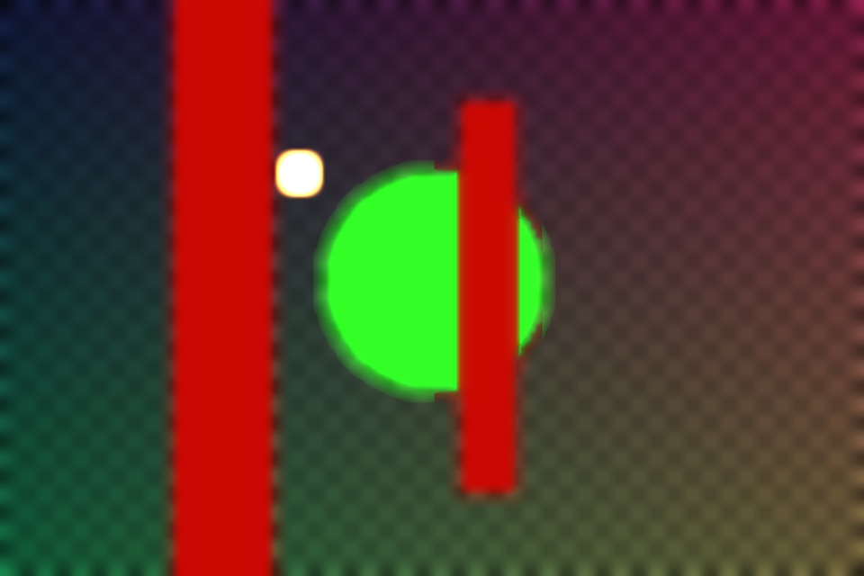
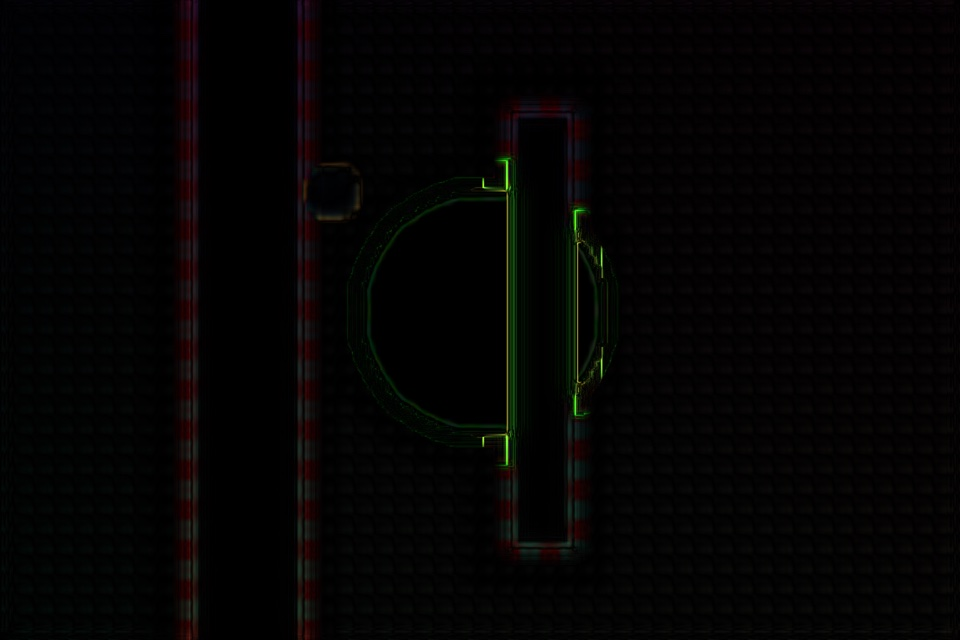

# <i class="fa-solid fa-star"></i> Quality

This is a feature that makes it possible for *OpenDefocus* to render complicated shapes but having a fast preview.

> [!TIP]
> Large bokehs and lots of motion show the difference between Fast and Accurate most. Check them in Accurate before the final render.

The **Quality** parameter (Defocus tab) has two choices: `Fast` and `Accurate`. The default is `Accurate`.

* `Fast` is a quick approximation of `Accurate` with the same features. It renders at half resolution, upsamples the result and keeps pixels the blur does not change at full resolution. Expect slightly softer or noisier bokeh edges; in-focus areas stay sharp.
* `Accurate` is exact and slower.

It is recommended to set the quality to Fast during compositing work, and to Accurate for the final render.

> Quality settings: Fast (first), Accurate (second) and their difference, amplified 8 times (third).

---
