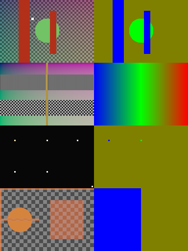

# Analytic rendering diagnostics

Four complementary 192 × 128 scenes, evaluated analytically at pixel centers.
The Rust module `xtask/src/fixtures/scenes` is the scene source: no Blender installation, external assets,
random sampling, or current-renderer output is needed to reproduce these inputs.
The suite deliberately targets isolated failure modes rather than photorealism.



Rows are `occlusion`, `focus_ramp`, `hdr_points`, `alpha_edges`. Left: input
color composited on a checker; right: signed CoC (blue near, green focus, red far).

| Scene | What to inspect |
| --- | --- |
| `occlusion` | Near red slats, in-focus green disk and far checker; HDR light beside a slat. Inspect foreground spread, background leakage and halos at depth jumps. |
| `focus_ramp` | Smooth near-to-far transition, narrow exact-focus marker, one-pixel stripes and three-pixel checker. Inspect sharpness through focus, gradient banding and fine-detail aliasing. |
| `hdr_points` | Identical small emitters at near, focus and far depths; linear intensities up to 128; clipped corner emitter. Inspect highlight energy, aperture orientation and border loss. `aperture.exr` is an off-center notched disk, deliberately asymmetric. |
| `alpha_edges` | Opaque antialiased near disk, 35%-opaque far rectangle, 65%-opaque top/left borders and a line spanning the 64-pixel stripe boundary. Inspect premultiplied edge fringes, alpha spread, borders and stripe joins. |

## Input contract

- `color.exr`: uncompressed **32-bit FLOAT** linear sRGB (Rec.709 primaries),
  RGBA with **premultiplied alpha**, including RGB above 1. No display transform.
  Zero-alpha pixels have zero RGB. HDR RGB may exceed alpha: this is intentional.
- `depth.exr`: positive camera distance in **meters**, copied into R/G/B; A=1.
  The synthetic camera is orthographic, square pixels, focus distance 4 m.
  There is no Blender camera or physical path tracing. The charts are analytic
  surfaces, and single-layer depth cannot encode hidden background or multiple
  transparent surfaces.
- `coc.exr`: signed **pixel radius**, R/G/B replicated, A=1.
  `coc = 24 * (1 - 4 / depth_m)`: negative near, zero focus, positive far.
  This explicit diagnostic mapping is not a claim that default camera settings
  reproduce it. Use **Depth mode and Direct math**, load R from `coc.exr`, maximum
  radius 24 px, size multiplier 1, proxy scale 1 and gamma correction 1.
  For camera-based tests, use `depth.exr` with a separately chosen camera and
  compare its CoC calculation independently.
- `preview.png`: RGB is composited over a linear checker, mapped with
  `RGB/(1+RGB)`, then encoded with the sRGB OETF. The exposure and curve are
  fixed across all scenes and evaluator outputs. It is **not renderer input**.
- `metadata.json`: per-scene camera, sampling, color, alpha, depth, CoC,
  provenance and license metadata.

The aperture image is a 33 × 33 linear float RGB mask replicated in three
channels with A=1; values are 0 or 1. Its PNG preview has the same orientation.
All geometry is specified in `xtask/src/fixtures/scenes/analytic.rs`; seed 0 records that no RNG is used.

## Regenerate and validate

From the repository root:

```sh
cargo xtask fixtures scenes
cargo xtask fixtures scenes --check
cargo test --release -p opendefocus --test diagnostic_assets --locked
```

`--check` regenerates in memory and compares EXR and JSON files byte-for-byte. PNG
files are compared by decoded pixels: zlib's DEFLATE stream is implementation-specific,
so the Rust encoder matches the committed pixels but not the committed container bytes.
Run it when changing the generator or regenerating assets. Regenerating rewrites the
PNGs with the Rust encoder, so review them against the contact sheet. The Rust asset test independently
loads the EXRs through the image decoder and checks dimensions, finite values,
alpha bounds, transparent RGB, depth/CoC conversion and custom mask asymmetry.
No rendering or Blender is needed for these integrity checks.

## Evaluate the existing library

```sh
cargo run --release -p opendefocus --example diagnostic_scenes -- ./diagnostic-results
```

The current evaluator always uses WGPU; initialization/render errors are returned.
Its historical `--gpu` flag no longer selects a separate renderer. Use an external
output path or gitignored `benchmark-results/` to avoid committing generated files.
Use `cargo xtask fixtures quality` for the independent static/lens matrix and
temporal sequences.

The evaluator uses the current public library, **High** quality, direct signed
CoC, circular aperture for all four scenes and a second custom-aperture pass for
`hdr_points`. It retains float32 EXRs, fixed-tone-map previews, a contact sheet
(input left, rendered right) and a numerical report. It checks finite output
and compares full-frame output against independently rendered 32/64-pixel
stripes with complete input halos. The stripe tolerance is 1e-5 absolute in
linear RGBA. Full input halos intentionally isolate stripe coordinates/joins;
this does not test host applications that crop or omit their padding.

On shared development machines, serialize builds/renders with the agreed OS
lock `/tmp/opendefocus-validation.lock`; never remove another task's lock.
Rendering is manual, not an expensive CI assertion. The saved evaluation gallery
in `evaluation/` records one named checkpoint, not an approved numerical oracle.
Renderer changes should produce a new gallery using the same settings, retain
HDR/alpha precision, and be inspected against the inputs and previous gallery.
A visual match alone does not prove physically correct occlusion or bokeh.

## Provenance and license

All scene definitions, generated source images, aperture and previews are new
original analytic fixtures created for OpenDefocus, dedicated under **CC0-1.0**.
See [LICENSE](LICENSE). No stock photography, models, downloaded textures or
third-party scene assets are used. Code outside this fixture directory retains
the repository's existing EUPL-1.2 license. Rendered evaluation images derive
only from these CC0 inputs; their metadata records the renderer revision.

## Ray-traced 3D scene

`render3d/` holds a 1920×1080 ray-traced scene (glossy spheres, emissive bokeh balls, checker
floor): `color.exr` (DWAA, about 1 MB; about 65 dB PSNR against the uncompressed render), a
lossless `depth.exr` with real Z depth (focal plane 6.0), and a `settings.json` overlay. Regenerate it with
`cargo xtask fixtures render3d` (optionally `--output-dir`). Use it to compare quality modes:

```sh
opendefocus-cli render3d/color.exr -o out.exr --depth render3d/depth.exr \
  --settings render3d/settings.json --quality fast
```
