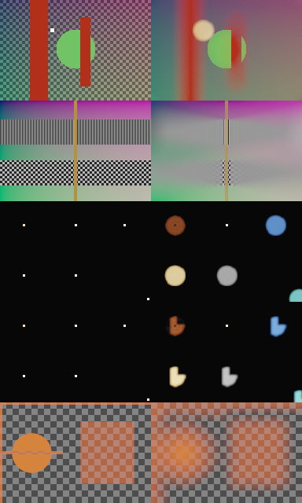
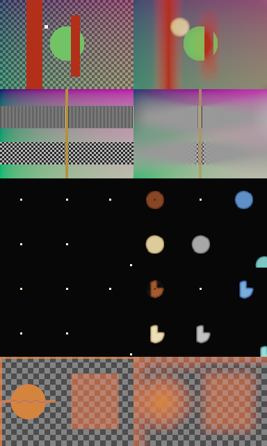

# Initial library evaluation

Renderer checkpoint: `c54e2342d2d5551eb5a21e911450198020506cba` (forge `main`).
CPU native and Apple M1/Metal, macOS arm64, High quality, direct signed CoC, maximum radius 24 px,
gamma 1. The renderer revision, evaluation checkout, backend and settings are recorded in `cpu_metadata.json` and `gpu_metadata.json`.
The renderer sources were unchanged; the fixture/evaluator files were local
additions at the time of this snapshot. Run the example to reproduce the gallery
and retain the full float32 output EXRs locally.

Left is input, right is rendered. Rows: occlusion, focus ramp, circular HDR
points, asymmetric HDR points (same input), premultiplied alpha edges. All
previews use the same tone curve and checker. Circular near/far highlights and
the aperture's notch should remain easy to identify on future revisions.

See [the numerical report](cpu_report.txt). All five passes on both backends were finite, and
32/64-pixel stripe outputs matched full-frame outputs exactly (maximum absolute
linear RGBA difference 0). These comparisons use complete halos, so they do not
validate a host application's padding or image loading.

**Diagnostic finding:** the custom-aperture pass on an opaque input has alpha
range **0.978598–1.019197**. This reveals under/overshoot in the current path;
it is preserved in the float result and report, without clamping or changing
filter precision/sampling to conceal it. This task adds fixtures, not a renderer
fix. The fixed preview composites the actual alpha, including overshoot.

RGB totals change, particularly for highlights near the clipped corner and
foreground transparency. The report records input/output totals for comparison;
there is no blanket conservation assertion for this depth/occlusion algorithm.
Visuals are diagnostics and historical snapshots, **not numerical correctness
or physically rendered reference images**. Analytic Z is single-layer and does
not describe hidden background or multiple transmissive surfaces. A dedicated
physical multi-layer reference remains future work.

## GPU comparison

The [GPU report](gpu_report.txt) records the same recipe on Apple M1/Metal.
Both stripe heights match full frames exactly, and the opaque custom-aperture
alpha range is **0.978731–1.019276**, reproducing the CPU observation. The
GPU evaluator refused CPU fallback, and this hardware run required Metal access
outside the development sandbox. Both heavy runs used the shared OS lock.

The galleries look similar but are not bit-identical numerical references.
For example, custom-aperture RGB totals are 4820.514297 (CPU) and 4789.671057
(Metal), while circular HDR totals are 4831.798473 and 4846.857632 respectively.
These backend differences are recorded for investigation; this fixture task
neither establishes an approved cross-backend tolerance nor changes the renderer.
